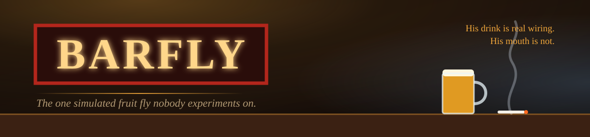
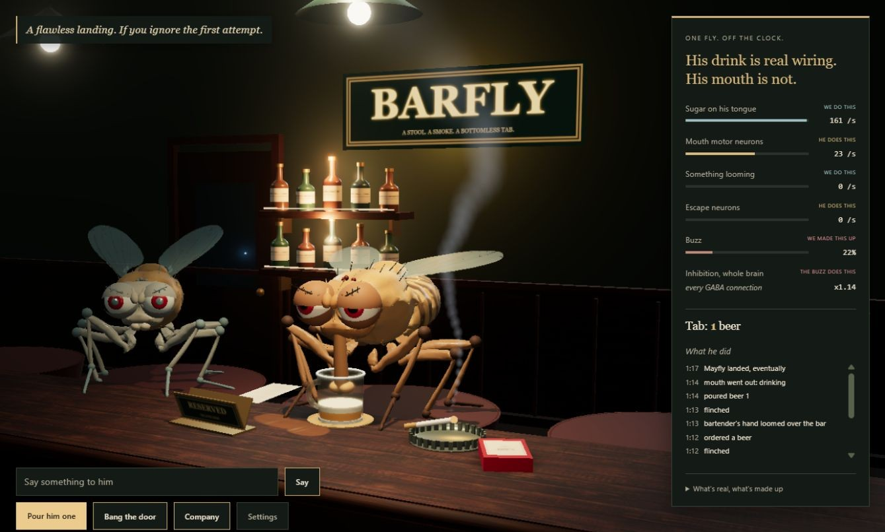
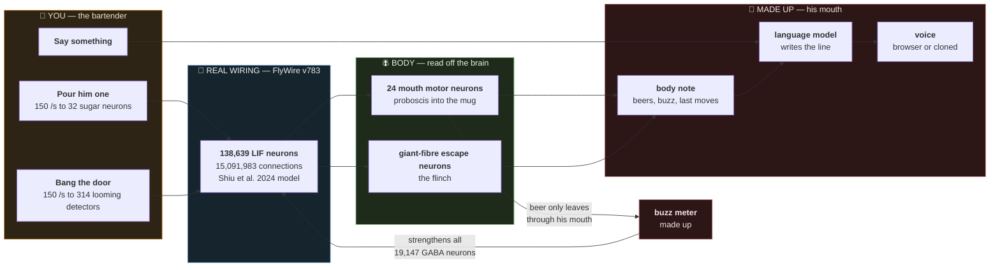

<div align="center">
  
</div>

<div align="center">

# 🪰 Barfly

**The one simulated fruit fly nobody experiments on.**
Every other fly brain on the internet has a job. This one has **a stool, a pack of smokes and a bottomless tab** —
and a whole connectome that really does decide when he drinks.

<br/>


**[Run it →](#-run-it)** · **[What's real →](#-whats-real-whats-bolted-on-whats-made-up)** · **[The numbers →](#-the-numbers)** · **[Not checked →](#not-checked)** · **[Credits →](#credits)**

</div>

---

> [!NOTE]
> **This is a bar, not a paper.** It makes no claim about fly behaviour, alcohol, or minds. It takes one
> well-studied reflex from a published whole-brain model, hangs a beer mug on it, and is strict about saying
> which parts are the wiring, which parts are engineering, and which parts were invented for the joke.

<div align="center">
  
  <br/>
  <sub>The running browser scene. His mouth is in the mug because his mouth neurons are firing.</sub>
</div>

## The premise

There is a small, wonderful scene of people wiring the fruit fly connectome into things. Fly brains play Doom.
They trade crypto. They work night security. Each one is a real repository with a README that usually admits,
with admirable honesty, what the fly can't actually do.

Barfly is the fly who opted out. Nobody trains him. Nobody scores him. He sits at the end of the bar, and you are
the bartender. You can do three things:

- **Pour him one.**
- **Bang the door.**
- **Say something to him.**

Everything he does about the first two comes out of a simulated brain. Everything he says about any of it comes
out of a language model that is handed a note describing what his body just did.

> ### His drink is real wiring. His mouth is not.

That sentence sits at the top of the page while he drinks, and the rest of this README is the long form of it.

## 🧭 What's real, what's bolted on, what's made up

Three tiers, and the panel beside him labels every meter with the one it belongs to.

| | tier | what it is | where |
|:--:|---|---|---|
| **1** | **Real wiring** | The FlyWire v783 connectome: **138,639 neurons, 15,091,983 connections**, each with a measured synapse count and a sign. Run as leaky integrate-and-fire neurons with the published parameters of Shiu et al. 2024. Nothing here is trained and nothing is tuned. | `src/brain/` |
| **2** | **Bolted on** | The interfaces. "Beer" is a 150 spikes-per-second signal sent straight to **32 sugar taste neurons**. "The door" is the same kind of signal sent to **314 looming detectors**; it is not something he sees. On the way out, his **24 proboscis motor neurons** drive the mouth and his two giant-fibre escape neurons drive the flinch. | `src/main.ts` |
| **3** | **Made up** | The buzz meter, the bar, the mug, the smokes, the eyes, the wings sagging, and every word he says. | `src/bar.ts`, `src/chat.ts` |

The interesting behaviour lives in the gap between tier 2 going in and tier 2 coming out. That gap is fifteen
million connections wide and nobody on this project wrote any of it.



Note which way the arrows run. The language model reads the body. **Nothing it says goes back into the brain.**

## 📏 The numbers

All of these come from headless runs of the same engine the page uses. One run each, one random seed, one second
of simulated time. Treat them as a first look.

### The two reflexes, and the fact that they're separate

| what we did to him | mouth motor neurons | escape neurons |
|---|--:|--:|
| nothing | 0 /s | 0 /s |
| sugar on the tongue | **28.0 /s** | 0 /s |
| sugar taken away | 0.6 /s | 0 /s |
| something looming | 3.5 /s | **248 and 285 /s** |

Sugar makes him drink and does not make him flinch. Looming makes him flinch and barely touches his mouth.
Take either away and he goes quiet, which is why an empty bar is just a fly on a stool.

### The thing nobody wrote: a flinch interrupts a sip

Bang the door while he is drinking and he stops, flares, and goes straight back to the beer. There is no line of
code for that. The sugar signal stays on the whole time; his mouth follows his mouth neurons and nothing else.

| stimulus | mouth motor neurons |
|---|--:|
| sugar alone | 26.8 /s |
| sugar **and** looming, together | **4.2 /s** |

Escape outranks feeding somewhere in those fifteen million connections, and feeding resumes the moment the threat
is gone. It was noticed by a person watching him, not predicted.

### What the beer does to his whole brain

The map is wiring, and alcohol is chemistry, so he cannot get drunk on his own. But every neuron in the dataset
is tagged with the transmitter it uses, and **19,147 of them use GABA**, the main "quiet down" signal. So the
buzz meter does exactly one thing to his brain: it multiplies the strength of every connection those neurons make.
That is a cartoon of real pharmacology. Everything downstream of it is his.

| inhibition | mouth neurons, tasting sugar | escape neurons, door bang |
|:--:|--:|--:|
| ×1.00 (sober) | 26.8 /s | 266 /s |
| ×1.25 | 17.5 /s | 240 /s |
| ×1.50 | 9.1 /s | 213 /s |
| ×2.00 | **0.3 /s** | 147 /s |
| ×3.00 | 0.1 /s | 98 /s |

The drunker he gets, the slower he drinks and the duller his flinch. At twice the inhibition he sits in front of
a full beer and cannot drink it. **The connectome has no stomach, and this gave him a limit anyway.** The page caps
the multiplier at ×1.7 so a maxed-out Barfly nurses his beer instead of locking up.

Reproduce it with `npm run probe:drunk`.

A dead end, reported because it is one: driving the dopamine neurons in the background, in the hope of a
happy-drunk knob, just shut his drinking off (28.0 → 2.5 /s). The model treats neuromodulators as plain fast
synapses, so that result says more about the model than about dopamine. It was left out.

## 💬 His mouth

Open **Settings** and pick who writes his lines. The model list is always fetched from the provider, never typed in.

| provider | needs | notes |
|---|---|---|
| **LM Studio**, this machine | nothing | free and private; a dot marks the model already loaded |
| **LM Studio**, a second machine | an address in `.env.local` | same |
| **OpenAI** | an API key | |
| **Anthropic** | an API key | uses the official SDK |
| **OpenRouter** | an API key | lists every model your account can use |

Keys are stored in your browser and go nowhere else. With a cloud provider, what you type and the note about his
body are sent to that company; the dialog says so next to the key field.

Before each thing you say, the model is handed a note built from his actual state:

```
[Body note. Beers on your tab tonight: 3. You are buzzed. Your mug is half full.
Your mouth is in the beer right now. Most recent things your body did, newest
first: flinched; door banged open; mouth went out: drinking; poured beer 3.
You have been on this stool about 11 minutes this sitting.]
```

He is told to treat it as true and never to read it back. So the comedy has a shape: **his body does something
real and involuntary, and his mouth has to account for it.** He jumps out of his skin at the door, and then he
has to say something.

His whole character is one text box in Settings. It saves as you type. The first draft ships in `src/chat.ts`,
and it is meant to be torn up.

## 🎙 His voice

Two options, chosen in Settings:

- **The browser's built-in voice.** Works immediately. Pitched down, and slower the drunker he is.
- **A cloned voice**, from the small server in `voice/`. It wraps
  [Chatterbox-Turbo](https://github.com/resemble-ai/chatterbox) (MIT), which clones a voice from about ten seconds
  of audio. Drop a clip into `voice/voices/`; the file name becomes the voice. With a cloned voice selected, his
  persona gains the nine sounds the model can perform mid-line, among them `[cough]`, `[sigh]`, `[groan]` and
  `[chuckle]`. He smokes, so the cough gets used. The server plays him slower and lower as the buzz climbs, like a
  tape running down. It also has its own page at `http://127.0.0.1:8880/ui` for trying voices and saving new ones.

A voice model reads out anything it is handed. Stage directions, made-up sound tags and stray non-English text all
come out as gibberish, so every line is stripped down to speech before it reaches either voice.

Only clone a voice you have the right to use: your own, or one made for the purpose.

## 🧰 Run it

You need **Node 22.18 or newer** and, for the one-time data step, [uv](https://docs.astral.sh/uv/).

```bash
git clone https://github.com/rustyorb/barfly.git
cd barfly
npm install
npm run data    # downloads FlyWire v783 (~135 MB) and packs it to 34 MB in public/data/brain/
npm run dev     # http://localhost:5188
```

After that first time, **`start-barfly.cmd`** (Windows) starts everything in one go: his voice if it is installed,
the bar, and the page in your browser. It skips whatever is already running. `start-barfly.cmd --check` shows what
it would do without doing it.

The brain, the bar and both buttons work with nothing else installed. To hear him answer, start LM Studio's local
server (or add a key in Settings).

Machine-specific addresses go in `.env.local`, which is never committed. See [`.env.example`](.env.example).

<details>
<summary><b>The cloned voice (optional, needs an NVIDIA GPU or patience)</b></summary>

```bash
cd voice
uv venv --python 3.11 .venv
uv pip install --python .venv/Scripts/python.exe torch==2.6.0 torchaudio==2.6.0 --index-url https://download.pytorch.org/whl/cu124
uv pip install --python .venv/Scripts/python.exe -r requirements.txt
start-voice.cmd          # port 8880; the page finds it on reload
```

Put a ten-second clip in `voice/voices/` first. Any OpenAI-style speech server on port 8880 works in its place,
including Kokoro-FastAPI.

</details>

> [!WARNING]
> **Read the honest version before quoting any of this.**
> - **He is a she.** FlyWire v783 is an adult *female* brain. "He" is the character, not the dataset.
> - **It is a model's behaviour, not a fly's.** None of the numbers above were compared with real animals here.
>   The sugar-to-proboscis response is the part with published experimental backing, in Shiu et al.
> - **One run, one seed.** The tables are a first look, not a result.
> - **The door is not seen.** It is a current injected into looming detectors. No eye is modelled.
> - **"Alcohol strengthens GABA" is a cartoon.** Real ethanol does a great deal more than that.
> - **It only runs from the dev server.** The model providers are reached through Vite's proxy, so a static
>   build has a working brain and a silent fly.
> - **The brain data is non-commercial.** FlyWire is CC BY-NC 4.0. The code is MIT; a show that makes money
>   would need a different connectome.

### Not checked

Stated plainly, as of the first commit:

- **OpenAI and Anthropic with a real key.** The routes reach both companies and are refused correctly without a
  key. OpenRouter and LM Studio have been used end to end.
- **How the cloned voice sounds.** The server runs and returns audio: about two seconds per line on a 12 GB RTX A2000 after a slow first line, using 5.4 GB of video memory. Whether it sounds like the clip, and whether the sound tags land, is a judgement for ears.
- **Any browser but Chromium**, and any machine but the one it was built on.
- **Grooming.** The third thing a fly at a bar ought to do. The engine this is built on tracks sugar and looming
  only.

## His look

The body now uses a bundled **GLB model** made from [NeuroMechFly / FlyGym's scan-derived fruit-fly meshes](https://neuromechfly.org/),
with separate head, thorax, abdomen, wing and leg geometry. The source meshes are lightly smoothed and rescaled to
Barfly's existing animation rig. His expressive eyes, lids, antennae and mouth animation remain theatrical additions.
**This changes the picture, not the connectome.** It does not run FlyGym's physics or alter the brain's wiring.

The counter uses [Wood Table by Dimitrios Savva / Poly Haven](https://polyhaven.com/a/wood_table), with local color and
normal maps. Paneled walls, bottle shelves, pendant lamps, brass trim, richer glass and softer smoke fill out the room.
The provenance text is under **What's real, what's made up**; all the original neuron readouts and settings remain available.

Visual assets live in `public/art/`, including the standalone `fruit-fly.glb`, upstream Apache-2.0 license and a
`sources.json` manifest with the pinned source revision and download hashes. They load locally and require no extra packages.
To regenerate them from the original sources, run `npm run assets` (this command needs internet access).

Checked on October 12, 2026: TypeScript and production build; the live browser's drink, empty-mug, door/flinch and
timed smoking flows; desktop and 390-pixel-wide framing; Settings opening and closing. No browser JavaScript errors
were recorded during those checks. Voice and language-model replies were not part of this visual check.

### Life at the world's smallest dive bar

- **A bartender's enormous hand** carries in each beer and sets it on his coaster. Its approach sends the same
  looming stimulus used by the door; the escape neurons determine whether he flinches. The taste stimulus starts
  after the mug is placed, and beer still leaves it only through his mouth-neuron output.
- **Drunk cigarette mistakes:** he occasionally misses his mouth, turns the cigarette around to inspect the lit
  end, corrects himself, and takes a drag. A real flinch interrupts the routine and makes him put it down.
- **Visitors with questionable flying skills:** they overshoot the stool, loop back, and land with dignity.
  **Company** invites one immediately. With no language model selected, visitors can stop by silently; with a model,
  the original two-line conversation flow remains available. Automatic visits still follow the Company setting.
- **His reserved corner:** a stained coaster, a brass RESERVED / HE LIVES HERE sign, a crimped bottle-cap ashtray,
  and an unpaid receipt that grows with his tab. Small glossy beer spills and soft contact shadows settle the props
  onto the counter.
- **Occasional captions**, including "He has reconsidered absolutely nothing." They are written bar jokes,
  separate from his language-model dialogue.

The cigarette routine, visitor choreography, bartender choreography, props and captions are theatrical additions.
They do not implement nicotine pharmacology, new behavioral circuits, or a brain for the visitors. The bartender
reuses the existing looming input, while the drinking and escape outputs still come from the existing simulation.
Checked on October 12, 2026: production build; delivery and visitor lifecycle checks; drunk cigarette recovery and
interruption checks; live hand/flinch, drinking, cigarette mishap and silent visitor flows. Model and voice replies
remain outside these checks. The 390-pixel phone view also fits the controls and widens to show both flies during visits.

## Layout

```
barfly/
├── start-barfly.cmd      one launcher: voice, bar, browser; skips what is already up
├── index.html            the bar, the panel, the settings dialog
├── src/
│   ├── main.ts           the loop: what we do to him, what he does about it, the buzz
│   ├── bar.ts            set dressing -- stool, mug, smokes, a tab that grows per beer, the door
│   ├── chat.ts           his mouth -- five providers, the body note, the first-draft persona
│   ├── settings.ts       who speaks for him, with what key, in what voice, as whom
│   ├── brain/            the whole-brain engine, from doodle-fly; +1 message to rescale GABA
│   └── fly3d/            scan-derived meshes on the doodle-fly rig; eyes, lids, sag and sway
├── scripts/
│   ├── build_data.py     downloads and packs the connectome (from doodle-fly)
│   └── drunk-probe.ts    the inhibition and dopamine tables above, headless
├── voice/
│   ├── server.py         Chatterbox-Turbo behind two OpenAI-style routes
│   ├── ui.py             the model's own Gradio demo, sharing the one loaded model, at /ui
│   └── voices/           your ten-second clips go here; never committed
└── .env.example          where machine addresses go instead of the code
```

## Where this is going

- **Guests.** The point of a bar is who walks in. The plan is other fly brains, each a real project with a real
  repository, coming in after a shift and carrying whatever their own README admits to. Barfly gives them
  terrible advice.
- **The shot list.** The log on the panel already timestamps everything his body does. Run the brain first, let
  it write the list of what happened and when, and shoot the episode to match. Some nights he may not touch his beer.
- **Grooming**, so he can stop mid-sentence to clean his face.

## Credits

Almost none of the hard parts were written here. That is the point of the project and it should be said first.

- **Brain engine, connectome packing and the animation rig:** [dtecx/doodle-fly](https://github.com/dtecx/doodle-fly) (MIT).
  A fruit fly's whole brain playing a jumping game in a browser tab, with an unusually careful account of what is
  wired and what is hand-made. Barfly is that fly with the game taken away. See [`LICENSE-doodle-fly`](LICENSE-doodle-fly).
- **Body anatomy:** [NeuroMechFly / FlyGym](https://github.com/NeLy-EPFL/flygym), NeLy / EPFL (Apache-2.0).
  Meshes derived from a real fly's micro-CT scan, converted to GLB and adapted for this character. See
  [`public/art/LICENSE-NeuroMechFly.txt`](public/art/LICENSE-NeuroMechFly.txt) and [`public/art/sources.json`](public/art/sources.json).
- **Wood material:** [Dimitrios Savva / Poly Haven, Wood Table](https://polyhaven.com/a/wood_table) (CC0).
- **The bartender's hand:** [Hand-arm by Thunk3D scanner](https://sketchfab.com/3d-models/hand-arm-199e194fb33846e29e9f5a1a58f0b94b) ([CC BY 4.0](https://creativecommons.org/licenses/by/4.0/)), a scan of a real hand, reduced from 3.1 million triangles to about 63,000. Changes are listed in [`public/art/sources.json`](public/art/sources.json).
- **Connectome:** Dorkenwald, S. *et al.* Neuronal wiring diagram of an adult brain. *Nature* 634, 124–138 (2024);
  Schlegel, P. *et al.* Whole-brain annotation and multi-connectome cell typing of *Drosophila*. *Nature* 634,
  139–152 (2024). Cell types from [flyconnectome/flywire_annotations](https://github.com/flyconnectome/flywire_annotations).
  FlyWire data: [CC BY-NC 4.0](https://creativecommons.org/licenses/by-nc/4.0/).
- **Brain model:** Shiu, P. K. *et al.* A *Drosophila* computational brain model reveals sensorimotor processing.
  *Nature* 634, 210–219 (2024); inputs from [philshiu/Drosophila_brain_model](https://github.com/philshiu/Drosophila_brain_model) (MIT).
- **Voice:** [Chatterbox](https://github.com/resemble-ai/chatterbox) by Resemble AI (MIT).
- **The map of who else is doing this:** [cobanov/awesome-fly](https://github.com/cobanov/awesome-fly).
- Built with [three.js](https://threejs.org) and [Vite](https://vitejs.dev).

Barfly's own code is [MIT](LICENSE).

---

<div align="center">

*Sixty people wired a fly brain into something. This is the one where it gets to sit down.*

**[🍺 Run it](#-run-it)** · **[🧭 What's real](#-whats-real-whats-bolted-on-whats-made-up)** · **[📏 The numbers](#-the-numbers)** · **[🙏 Credits](#credits)**

</div>
